# 🔧 Industrial Comparison Analysis System (ICAS)

## Presentation Document — Implementation Details

---

## 1. Project Overview

The **Industrial Comparison Analysis System (ICAS)** is a production-grade, multi-module platform for industrial torque report processing. It provides two core capabilities:

1. **Report Generation** — Transforms raw MBOM (Manufacturing Bill of Materials) exports into standardized, business-ready torque reports.
2. **Comparison Engine** — Compares two versions of torque reports (OLD vs NEW) and automatically classifies every part into one of four categories:

| Category | Meaning |
|---|---|
| ⚪ **No Change** | Part exists in both reports with identical values |
| 🟡 **Modified** | Part exists in both but one or more fields changed |
| 🟢 **New** | Part only exists in the NEW report |
| 🔴 **Deleted** | Part only exists in the OLD report |

The system also includes a **Dashboard** with activity logging, KPI metrics, and comparison summaries, plus **session-based authentication** for secure access.

> [!IMPORTANT]
> The entire system is **rule-based** — no AI/LLM is used for classification or logic. All decisions are deterministic Python code.

---

## 2. Technology Stack

| Layer | Technology | Version | Purpose |
|---|---|---|---|
| **Language** | Python | 3.11+ | Core logic |
| **UI Framework** | Streamlit | 1.56.0 | Interactive web dashboard |
| **Data Processing** | Pandas | 3.0.2 | DataFrame operations, merging, filtering |
| **Excel Reading** | openpyxl | 3.1.5 | Reading/writing `.xlsx` files |
| **Fast Excel Reader** | python-calamine | 0.6.2 | Rust-based Excel reader (~7x faster) |
| **Excel Writing** | XlsxWriter | 3.2.9 | Formatted Excel report generation |
| **Authentication** | streamlit-authenticator | 0.4.2 | Session-based login with bcrypt |
| **Charts** | Plotly | 5.22.0 | Dashboard analytics visualizations |
| **Deployment** | Local / Streamlit Cloud | — | Runs as a web app on `localhost:8501` |

### Key Libraries
```
streamlit                → Web UI framework (reactive, no frontend code needed)
pandas                   → Data manipulation and comparison engine
openpyxl                 → Excel file reader/writer
python-calamine          → Rust-based fast Excel reader (MBOM loading)
xlsxwriter               → Professional Excel output with formatting
streamlit-authenticator  → Session-based authentication with bcrypt
plotly                   → Interactive dashboard charts
```

---

## 3. System Architecture

```mermaid
graph TB
    subgraph AUTH["🔐 Authentication Layer"]
        LOGIN["Session-Based Login<br/>bcrypt + cookie"]
    end

    subgraph NAV["📱 Navigation Shell"]
        DASH["🏠 Dashboard"]
        RG["📄 Report Generator"]
        CE["⚙️ Comparison Engine"]
    end

    subgraph REPORT["📄 Report Generation Pipeline"]
        MBOM["Raw MBOM Upload (.xlsx)"]
        HD["Header Detection<br/>(Fast Path + Fallback)"]
        BF["Business Filtering<br/>(PART STATUS, TORQUE SAFETY)"]
        FM["Field Mapping<br/>(MultiIndex → Flat)"]
        DD["Deduplication<br/>(Subset-Based)"]
        RID["Row ID Generation<br/>(Vectorized)"]
        ROUT["Formatted Report Export"]
    end

    subgraph COMPARISON["⚙️ Comparison Pipeline"]
        OLD["OLD Report (.xlsx)"]
        NEW["NEW Report (.xlsx)"]
        NORM["Column & Type<br/>Normalization"]
        KEY["9-Column Composite<br/>Key Build"]
        SET["Set Math<br/>Classification"]
        DGR["Duplicate Group<br/>Rescue"]
        RP["Rescue Pass<br/>(Phase A + B)"]
        ACT["Actionability<br/>Classification"]
        COUT["4 Output DataFrames<br/>+ Excel Export"]
    end

    LOGIN --> NAV
    DASH --> NAV
    RG --> REPORT
    CE --> COMPARISON
    MBOM --> HD --> BF --> FM --> DD --> RID --> ROUT
    OLD --> NORM
    NEW --> NORM
    NORM --> KEY --> SET --> DGR --> RP --> ACT --> COUT

    style AUTH fill:#1a1a2e,stroke:#e94560,color:#fff
    style NAV fill:#0f3460,stroke:#53a8b6,color:#fff
    style REPORT fill:#16213e,stroke:#0f3460,color:#fff
    style COMPARISON fill:#16213e,stroke:#0f3460,color:#fff
```



---

## 4. Project Structure

```
c:\project\FCS\
├── app.py                              ← Main Streamlit entry point (routing + auth)
├── requirements.txt                    ← Python dependencies
├── .env                                ← Environment variables
├── .gitignore                          ← Git exclusions
│
├── auth/                               ← Authentication
│   ├── __init__.py
│   ├── config.py                       ← Builds auth config from secrets.toml
│   └── hasher.py                       ← Password hashing utility
│
├── .streamlit/
│   └── secrets.toml                    ← User credentials + cookie config
│
├── report_generator/                   ← Report Generation Module
│   └── builder.py                      ← Full MBOM-to-report pipeline
│
├── comparison_engine/                  ← Comparison Engine Module
│   ├── comparator.py                   ← Core 9-key comparison engine
│   ├── comment_engine.py               ← Priority-ordered comment generator
│   ├── duplicate_group_rescue.py       ← Weighted similarity rescue for duplicate groups
│   └── rescue_pass.py                  ← Post-comparison false Added/Deleted rescue
│
├── preprocessing/                      ← Data Preprocessing
│   ├── analysis.py                     ← Column detection & normalization
│   ├── normalizer.py                   ← DataFrame column normalizer
│   ├── structure_analyzer.py           ← Hybrid header detection (fast + fallback)
│   └── type_normalizer.py              ← Data type normalization (float, int, date)
│
├── config/                             ← Centralized Configuration
│   ├── actionability_rules.py          ← ACTION REQUIRED / REVIEW CATEGORY rules
│   ├── business_rules.py               ← PART STATUS, TORQUE SAFETY, TRGT filters
│   ├── column_mapping.py               ← MultiIndex → flat column mapping
│   ├── comparison_identity.py          ← 9-column business identity definition
│   ├── debug_config.py                 ← Debug mode toggle
│   ├── deduplication_config.py         ← Deduplication subset columns
│   ├── duplicate_group_rescue_config.py← DGR weights, thresholds, toggles
│   ├── report_schema.py                ← Authoritative 28-column output schema
│   ├── report_structure_config.py      ← Known EBOM template structure
│   ├── rowid_config.py                 ← Row ID generation rules
│   └── smart_rematch_config.py         ← Smart re-match analysis config
│
├── validation/                         ← Business Validation
│   ├── actionability_classifier.py     ← ACTION REQUIRED + REVIEW CATEGORY engine
│   ├── business_filters.py             ← Pre-comparison business filters
│   ├── business_identity_validator.py  ← Identity key validation
│   └── deduplication_validator.py      ← Duplicate detection & removal
│
├── analysis/                           ← Advanced Analysis
│   └── smart_rematch_simulator.py      ← Smart re-match analysis (analytical only)
│
├── ui/                                 ← UI Layer (Streamlit)
│   ├── styles.py                       ← Global CSS injection
│   ├── components.py                   ← Shared UI components (sidebar branding)
│   ├── dashboard.py                    ← Dashboard page renderer
│   ├── dashboard_components.py         ← Dashboard KPIs, activity log, charts
│   ├── dashboard_styles.py             ← Dashboard-specific CSS
│   ├── dashboard_service.py            ← Dashboard data service
│   ├── analytics_service.py            ← Analytics data processing
│   ├── comparison_page.py              ← Comparison Engine page
│   ├── comparison_components.py        ← Comparison UI cards & panels
│   ├── comparison_styles.py            ← Comparison-specific CSS
│   ├── comparison_ui.py                ← Comparison render entry point
│   ├── report_generator_page.py        ← Report Generator page
│   ├── report_generator_components.py  ← Report Generator UI cards
│   ├── report_generator_styles.py      ← Report Generator CSS
│   ├── report_generation_ui.py         ← Report Generator render entry point
│   ├── login_components.py             ← Login page branding panel
│   ├── login_styles.py                 ← Login page CSS
│   └── expleo_logo.png                 ← Company branding asset
│
├── exports/                            ← Excel Export Layer
│   ├── common/
│   │   ├── base_formatting.py          ← Shared openpyxl formatting rules
│   │   └── utils.py                    ← Excel sanitization utilities
│   ├── comparison_export/
│   │   ├── comparison_exporter.py      ← 4-sheet comparison Excel export
│   │   ├── comparison_filename.py      ← Dynamic filename generation
│   │   └── comparison_formatting.py    ← Comparison-specific formatting
│   └── report_generation_export/
│       ├── report_exporter.py          ← Single-sheet report Excel export
│       ├── report_filename.py          ← Report filename generation
│       └── report_formatting.py        ← Report-specific formatting
│
├── utils/                              ← Utility Modules
│   ├── dashboard_logger.py             ← Activity logging (JSON persistence)
│   ├── ingestion.py                    ← File ingestion helper
│   ├── performance_timer.py            ← Pipeline step timer
│   └── rowid_generator.py              ← Vectorized Row ID engine
│
├── data/                               ← Runtime Data
│   ├── activity_log.json               ← Persistent activity history
│   └── latest_comparison_summary.json  ← Latest comparison metrics
│
├── scripts/
│   └── verify_reports.py               ← Report verification utility
│
├── tests/
│   └── test_comparator.py              ← Automated test suite
│
└── venv/                               ← Python virtual environment
```

---

## 5. Module Breakdown

### Module 1: Report Generation (`report_generator/builder.py`)

**Purpose:** Transform raw MBOM (Manufacturing Bill of Materials) Excel exports into standardized, business-ready torque reports.


**Pipeline Steps:**

| # | Step | Description |
|---|---|---|
| 1 | **Schema Resolution** | Load authoritative 28-column schema from `config/report_schema.py` |
| 2 | **Header Detection** | Fast path (known EBOM template) → Fallback (dynamic row scanning) |
| 3 | **Normalization** | Multi-level header analysis + column name normalization |
| 4 | **Business Filtering** | PART STATUS = `R`, TORQUE SAFETY = `Y` or `N`, optional TRGT filter |
| 5 | **Field Mapping** | Map raw MultiIndex columns to flat target schema via explicit rules + leaf fallback |
| 6 | **Type Normalization** | Cast numeric/integer/date columns to proper dtypes |
| 7 | **Deduplication** | Remove duplicates on business field subset (MODEL YEAR + VEH FAM + PART NO + ...) |
| 8 | **Row ID Generation** | Vectorized unique identifier per row |
| 9 | **Category Optimization** | Convert low-cardinality columns to `category` dtype |
| 10 | **Schema Ordering** | Reorder columns to match authoritative report schema |

**Output Schema (28 columns):**
```
MODEL YEAR, PART NO, VEH FAM, VEH LINE, BODY STYLE, PART USAGE DESC,
PHYSCL DESC, QUANTITY, DEPT_REL, TORQUE SAFETY, TIGHTENING CLASS,
TORQUE STRATEGY, MIN, TRGT, MAX, TORQUE SNUG TARGET, TRGT2,
DECISIONED CN #, DECISION DATE, VSC, VSC NAME, END ITEM PART,
ENGINE, TRANSMISSION, CONDITION DESC, NOUN NAME, NOUN DESC,
COMMENTS, ROW ID
```

---

### Module 2: Comparison Engine (`comparison_engine/comparator.py`)

**Purpose:** Compare two datasets using a **9-column composite business identity key** and classify every row.

**9-Column Composite Key:**
```
__KEY__ = MODEL YEAR | PART NO | VEH FAM | VEH LINE | DEPT_REL |
          PART USAGE DESC | PHYSCL DESC | ENGINE | TRANSMISSION
```

**Flexible Column Resolution:** Each identity field accepts multiple naming variants:

| Logical Name | Accepted Variants |
|---|---|
| MODEL YEAR | `MODEL YEAR`, `MODEL_YEAR`, `MODELYEAR`, `MY` |
| PART NO | `PART NO`, `PART_NO`, `PARTNO`, `PART NUMBER` |
| VEH FAM | `VEH FAM`, `VEH_FAM`, `VEHFAM`, `VEHICLE FAMILY` |
| VEH LINE | `VEH LINE`, `VEH_LINE`, `VEHLINE`, `VEHICLE LINE` |
| DEPT_REL | `DEPT_REL`, `DEPT REL`, `DEPARTMENT`, `DEPT` |
| PART USAGE DESC | `PART USAGE DESC`, `PART_USAGE_DESC`, `USAGE DESC` |
| PHYSCL DESC | `PHYSCL DESC`, `PHYSCL_DESC`, `PHYSICAL DESC` |
| ENGINE | `ENGINE`, `ENGINE CODE`, `ENGINE_CODE` |
| TRANSMISSION | `TRANSMISSION`, `TRANS`, `TRANSMISSION CODE` |

**Excluded from Comparison:**

| Column | Reason |
|---|---|
| ROW ID / ROW_ID / ROWID | Unique per row, always different |
| SR NO / SERIAL NO / S NO | Sequence number, always unique |
| COMMENTS | Generated column, not source data |
| INDEX | Internal identifier |
| __KEY__ | Internal composite key |

**Post-Comparison Layers:**

1. **Duplicate Group Rescue** — Re-evaluates positional matching within duplicate identity groups using weighted similarity scoring
2. **Rescue Pass** — Phase A (6-column anchor) + Phase B (5-column core + ENGINE validation) to reclassify false Added/Deleted pairs as Modified
3. **Actionability Classification** — Classifies Modified/Added rows with ACTION REQUIRED (YES/NO) and REVIEW CATEGORY labels

---

### Module 3: Comment Engine (`comparison_engine/comment_engine.py`)

**Purpose:** Convert raw change dictionaries into human-readable, priority-ordered comment strings.

**Priority Field Sequence (Strict Order):**

| # | Field |
|---|---|
| 1 | TORQUE STRATEGY |
| 2 | TRGT |
| 3 | TORQUE SNUG TARGET |
| 4 | TRGT2 |
| 5 | PART USAGE DESC |
| 6 | PHYSCL DESC |
| 7 | QUANTITY |
| 8 | ENGINE |
| 9 | TRANSMISSION |
| 10 | NOUN DESC |

**Mode-Based Behavior:**

| Mode | COMMENTS Value |
|---|---|
| `modified` | Multi-line from CHANGES: `TRGT: 100 → 120` |
| `new` | Static: `"Completely New Part Added"` |
| `deleted` | Static: `"Part Removed in New Report"` |
| `nochange` | Static: `"No Changes Detected"` |

---

### Module 4: Actionability Classifier (`validation/actionability_classifier.py`)

**Purpose:** Post-comparison classification layer that adds ACTION REQUIRED and REVIEW CATEGORY columns to Modified and Added rows.

**Actionable Fields** (ACTION = YES if any changed):
- Torque: `TRGT`, `MIN`, `MAX`, `TRGT2`, `TORQUE SNUG TARGET`, `TORQUE STRATEGY`
- Applicability: `ENGINE`, `TRANSMISSION`

**Review Categories:**

| Category | Trigger |
|---|---|
| TRGT Change | TRGT value changed |
| Torque Change | MIN, MAX, TRGT2, TORQUE SNUG TARGET changed |
| Low Torque Change | Both old/new TRGT below threshold (non-actionable) |
| Engine Applicability Change | ENGINE changed |
| Transmission Applicability Change | TRANSMISSION changed |
| Torque Strategy Change | TORQUE STRATEGY changed |
| Administrative Change | Only non-actionable fields changed |
| New Engineering Record | Completely new part |
| New Low Torque Record | New part with low torque (non-actionable) |

---

### Module 5: Excel Export Layer (`exports/`)

**Comparison Export:** 4-sheet Excel workbook with color-coded tabs:

| Sheet | Tab Color | Content |
|---|---|---|
| No Change | Grey | Parts unchanged between reports |
| Modified | Amber | Parts with field changes + COMMENTS |
| New | Green | Parts only in NEW report |
| Deleted | Red | Parts only in OLD report |

**Report Generation Export:** Single-sheet formatted workbook.

**Common Formatting Features:**
- ✅ Auto-fit column widths
- ✅ Frozen header row
- ✅ AutoFilter on all columns
- ✅ Alternating row colors
- ✅ COMMENTS column highlighted (yellow background, text wrap)
- ✅ Color-coded sheet tabs
- ✅ Professional formatting with borders

---

### Module 6: Dashboard & Authentication

**Authentication:**
- Session-based login using `streamlit-authenticator`
- Bcrypt-hashed passwords stored in `.streamlit/secrets.toml`
- Cookie-based session persistence (7-day expiry)
- Modern split-pane login UI with company branding

**Dashboard Features:**
- KPI metric cards (total comparisons, reports generated, etc.)
- Activity log with timestamped operation history
- Latest comparison summary (No Change / Modified / Added / Deleted)
- Analytics section with interactive Plotly charts

---

## 6. Performance Optimizations

| Optimization | Implementation |
|---|---|
| **Caching** | `@st.cache_data` — heavy file I/O and comparison run only once per file pair |
| **Set operations** | Key matching uses Python `set` intersection/difference — O(n) |
| **Group dict** | Single `_build_group_dict()` call per dataset, O(1) lookups thereafter |
| **Pre-converted dicts** | Rows converted to dicts once, reused everywhere (no repeated pandas access) |
| **Fast Excel reader** | `python-calamine` (Rust-based) used as primary engine, openpyxl as fallback |
| **Precomputed masks** | Business filters build combined boolean mask → single DataFrame slice |
| **Category dtypes** | Low-cardinality string columns converted to `category` dtype |
| **Vectorized Row IDs** | Row ID generation uses vectorized pandas operations |
| **Pipeline timing** | Full step-by-step `PipelineTimer` instrumentation on both modules |
| **Filter = instant** | Sidebar/filter changes only re-filter cached DataFrames, no re-computation |

---

## 7. Key Design Decisions

| Decision | Rationale |
|---|---|
| **Rule-based, no AI** | Deterministic, auditable results. No API costs. Works offline. |
| **9-column composite key** | Single PART NO is not unique across model years, vehicle families, departments, and usage contexts |
| **Dynamic column detection** | Input files from different teams have different naming conventions |
| **Priority field ordering** | Domain experts need critical torque/quantity changes visible first |
| **4 categories** | "No Change" category needed because raw input files contain identical rows |
| **Dual rescue passes** | Duplicate Group Rescue (positional re-match) + Rescue Pass (false Add/Del) eliminate false positives |
| **Actionability classification** | Separates actionable torque changes from administrative noise |
| **ROW ID excluded from comparison** | Always unique, would make every row appear "modified" |
| **Date auto-conversion** | Excel stores dates as serial numbers — auto-detected and formatted to YYYY-MM-DD |
| **Config-driven architecture** | All business rules in `config/` — change behavior without touching engine code |

---

## 8. Testing

**Automated test suite** (`tests/test_comparator.py`) validates:

| Test | Assertion |
|---|---|
| File structure detection | KEY columns detected correctly |
| No Change classification | Identical rows → No Change (not Modified) |
| Modified detection | Changed values → Modified with correct CHANGES dict |
| New detection | Key only in NEW → New |
| Deleted detection | Key only in OLD → Deleted |
| Comment format | Priority ordering, newline separation |
| Excel export | 4 sheets in correct order, valid file |

```
ALL TESTS PASSED ✅
```

---

## 9. How to Run

### Prerequisites

- **Python 3.11 or higher** installed on your system
- **pip** package manager (comes with Python)

### Step-by-Step Setup

#### Step 1 — Verify Python Installation

```powershell
python --version
```

Expected output: `Python 3.11.x` or higher. If Python is not installed, download it from [python.org](https://www.python.org/downloads/).

#### Step 2 — Navigate to the Project Directory

```powershell
cd C:\project\FCS
```

#### Step 3 — Create a Virtual Environment

**If no `venv` folder exists** (first-time setup):
```powershell
python -m venv venv
```

**If `venv` already exists but is corrupted** (recreation):
```powershell
Remove-Item -Recurse -Force .\venv
python -m venv venv
```

#### Step 4 — Activate the Virtual Environment

```powershell
.\venv\Scripts\Activate.ps1
```

> [!NOTE]
> After activation, your terminal prompt should show `(venv)` at the beginning.
> If you get an execution policy error, run: `Set-ExecutionPolicy -ExecutionPolicy RemoteSigned -Scope CurrentUser`

#### Step 5 — Upgrade pip

```powershell
python -m pip install --upgrade pip
```

#### Step 6 — Install Dependencies

```powershell
pip install -r requirements.txt
```

This installs all required packages:
```
streamlit==1.56.0
pandas==3.0.2
xlsxwriter==3.2.9
openpyxl==3.1.5
streamlit-authenticator==0.4.2
python-calamine==0.6.2
plotly==5.22.0
```

#### Step 7 — Configure Authentication (First-Time Only)

Ensure the `.streamlit/secrets.toml` file exists with valid user credentials. This file contains bcrypt-hashed passwords and cookie settings required for the login system.

#### Step 8 — Launch the Application

```powershell
python -m streamlit run app.py
```

The application will start and open automatically at:
```
http://localhost:8501
```

#### Step 9 — Log In

Use your configured credentials to log in through the secure login interface.

### Quick Start (If venv Already Exists)

```powershell
cd C:\project\FCS
.\venv\Scripts\Activate.ps1
python -m streamlit run app.py
```

### Full Fresh Setup (Single Block)

```powershell
cd C:\project\FCS
Remove-Item -Recurse -Force .\venv
python -m venv venv
.\venv\Scripts\Activate.ps1
python -m pip install --upgrade pip
pip install -r requirements.txt
python -m streamlit run app.py
```

---

## 10. Summary

The ICAS system provides a complete industrial torque report processing platform that:

1. **Generates** standardized torque reports from raw MBOM exports (10-step pipeline with business filtering, field mapping, deduplication, and Row ID generation)
2. **Compares** two report versions using a 9-column composite business identity key (MODEL YEAR + PART NO + VEH FAM + VEH LINE + DEPT_REL + PART USAGE DESC + PHYSCL DESC + ENGINE + TRANSMISSION)
3. **Classifies** every row into 4 categories (No Change, Modified, New, Deleted)
4. **Rescues** false positives via Duplicate Group Rescue and a 2-phase Rescue Pass
5. **Labels** actionability (ACTION REQUIRED + REVIEW CATEGORY) for each Modified/Added row
6. **Generates** priority-ordered comments for Modified rows
7. **Displays** results in an interactive dashboard with KPIs, activity logging, and analytics
8. **Exports** professionally formatted Excel reports (4-sheet comparison + single-sheet generated report)
9. **Secures** access via session-based authentication with bcrypt-hashed credentials

All without any AI dependency — **100% deterministic, auditable, config-driven, and fast**.
