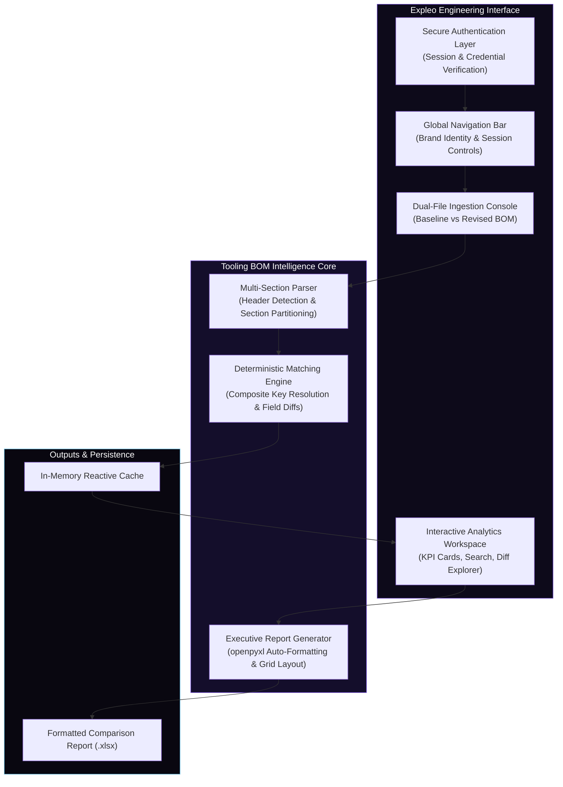

# Expleo Tooling BOM Intelligence Platform

**Automated Engineering Change Detection & Reporting System**

---

## 1. Executive Summary

The **Expleo Tooling BOM Intelligence Platform** is an enterprise-grade engineering analysis system designed to automate Bill of Materials (BOM) verification, delta classification, and discrepancy reporting across vehicle and industrial tooling revisions.

Engineered to replace manual spreadsheet cross-referencing, the system ingests baseline (OLD) and revised (NEW) engineering BOM datasets, executes deterministic identity-based matching, and produces audit-ready analytical reports with full field-level traceability.

### Core Capabilities:
- **Multi-Section Ingestion:** Handles structured tooling files including standard catalog items and customized tooling specifications.
- **Deterministic Delta Classification:** Automatically categorizes parts into:
  - **New Items:** Components introduced exclusively in the revised revision.
  - **Deleted Items:** Components removed or decommissioned from the baseline revision.
  - **Modified Items:** Components present in both revisions with differences in attributes, quantities, or technical specifications.
  - **No Change:** Components with identical values across all tracked fields.
- **Enterprise-Grade Excel Generation:** Produces clean, highly readable `.xlsx` workbooks equipped with executive KPI summaries, auto-filters, freeze panes, and standardized corporate styling.
- **Modern User Experience:** Built with a responsive, dark-mode engineering dashboard aligned with Expleo's corporate design language.

---

## 2. Technology Stack

| Domain | Technology | Version | Purpose |
|---|---|---|---|
| Language | Python | 3.11+ | Core analytical engine and backend processing |
| UI Framework | Streamlit | 1.56.0 | Reactive interactive web platform |
| Data Processing | Pandas | 3.0.2 | High-performance DataFrame transformations and vectorized matching |
| Excel Engine | openpyxl / XlsxWriter | 3.1.5 / 3.2.9 | Formatted workbook reading, writing, and styling |
| Fast Excel Reader | python-calamine | 0.6.2 | High-throughput Rust-based parser for large spreadsheets |
| Authentication | bcrypt / toml | Latest | Secure role-based session authentication |
| Visualization | Plotly | 5.22.0 | Dynamic KPI cards and statistical distribution plots |

---

## 3. System Architecture



---

## 4. Pipeline & Comparison Methodology

### Step 1: Multi-Section Ingestion
The file loader parses engineering spreadsheets, automatically identifying data boundaries across multiple sections:
- **Standard Tooling Section:** Catalog parts and standard tooling assemblies.
- **Non-Standard Tooling Section:** Specialized tooling fixtures, custom components, and plant-specific modifications.

### Step 2: Composite Key Resolution
Each item is matched across revisions using robust composite business keys combining component part numbers and item identifiers.

### Step 3: Field-by-Field Delta Inspection
For matching components, every attribute is inspected for modifications, including:
- Designation and technical descriptions
- Quantities and unit counts
- Supplier codes and reference parameters
- Assembly classifications and tracking codes

When differences occur, a structured change summary is produced (e.g., `Quantity: 2 -> 3; Status: Active -> Superseded`).

### Step 4: Executive Report Formatting
The export pipeline formats the results into an audit-ready multi-section workbook:
- **Row 1-2:** Clean corporate bilingual headers.
- **Row 3-4:** Exact source file references.
- **Row 6:** Executive KPI summary highlighting totals for New, Deleted, and Modified items.
- **Row 8+:** Data table with column auto-filters, freeze panes at row 10, alternating row zebra striping, and cell borders.

---

## 5. Repository Structure

```
├── app.py                     # Main Streamlit application entry point & routing
├── requirements.txt           # Python package dependencies
├── .gitignore                 # Version control exclusions
│
├── tooling_bom/               # Core Tooling BOM Intelligence Engine
│   ├── __init__.py
│   ├── column_config.py       # Tracked column definitions & priority mapping
│   ├── comparator.py          # Delta classification & field difference tracking
│   ├── exporter.py            # openpyxl formatted workbook generator
│   └── loader.py              # Multi-section spreadsheet parser
│
├── ui/                        # Presentation & Design System
│   ├── bom_comparison_ui.py   # Main comparison dashboard & results viewer
│   ├── login_view.py          # Enterprise login screen with Expleo design
│   ├── components.py          # Shared UI widgets & navigation elements
│   ├── styles.py              # Global Expleo CSS theme tokens
│   ├── expleo_logo.png        # Brand wordmark asset
│   ├── expleo_icon.png        # High-resolution circular brand mark
│   └── favicon.png            # Browser tab icon
│
├── comparison_engine/         # Advanced comparison algorithms
│   ├── comparator.py          # Multi-key comparator engine
│   ├── comment_engine.py      # Natural language change explanation generator
│   ├── duplicate_group_rescue.py # Disambiguation for duplicate keys
│   └── rescue_pass.py         # Advanced pairing recovery
│
├── config/                    # Business rules & schema definitions
│   ├── column_mapping.py      # Column alias & normalization dictionaries
│   ├── business_rules.py      # Engineering validation rules
│   └── report_schema.py       # Output schema standards
│
└── tests/                     # Automated unit and integration test suite
    └── test_comparator.py     # Deterministic classification tests
```

---

## 6. Installation & Setup

### Prerequisites
- Python 3.11 or higher
- Git
- Microsoft Windows, Linux, or macOS

### Step-by-Step Installation

1. **Clone the Repository:**
   ```bash
   git clone https://github.com/suyashchaudhari1821/BOM-AUTOMATION-.git
   cd BOM-AUTOMATION-
   ```

2. **Create a Virtual Environment:**
   ```powershell
   # Windows PowerShell
   python -m venv venv
   .\venv\Scripts\Activate.ps1
   ```

   ```bash
   # Linux / macOS
   python3 -m venv venv
   source venv/bin/activate
   ```

3. **Install Dependencies:**
   ```bash
   pip install --upgrade pip
   pip install -r requirements.txt
   ```

4. **Launch the Platform:**
   ```bash
   streamlit run app.py
   ```

5. **Access the Application:**
   Open your browser and navigate to:
   ```
   http://localhost:8501
   ```

---

## 7. Quality & Verification Standards

- **100% Deterministic:** Completely rule-based execution ensuring reproducible, verifiable outcomes across all runs.
- **Zero Cloud Leakage:** All data processing occurs locally within the execution environment with no outbound data transmission.
- **Corporate Compliance:** Strict alignment with engineering documentation best practices, formatted for cross-departmental sharing.
