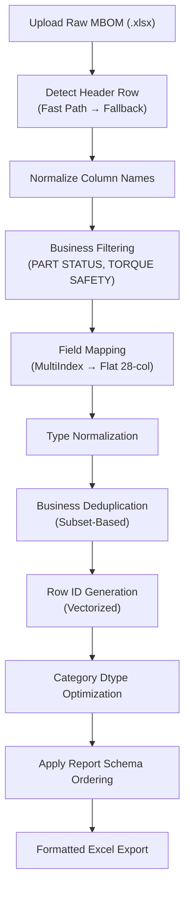
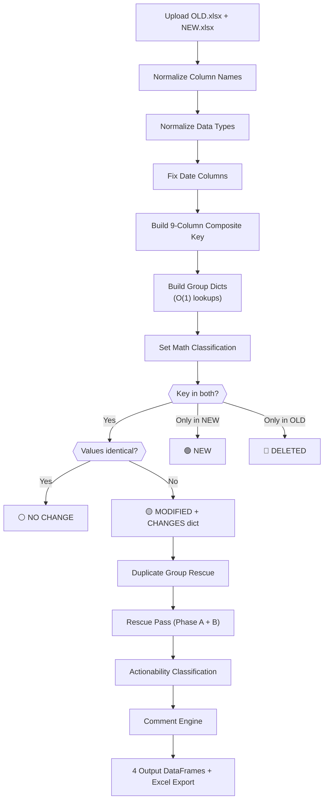
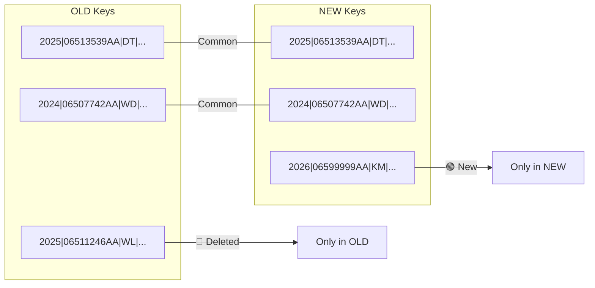

# ICAS Modules — Full Technical Deep-Dive

---

# Part A: Report Generation Module

---

## A1. High-Level Flow



---

## A2. Step-by-Step Detailed Breakdown

### STEP 1 — Schema Resolution

**File:** [report_schema.py](file:///c:/project/FCS/config/report_schema.py)

The target output schema is loaded from `config/report_schema.py`. This is the **code-level authority** — users do NOT need to upload a template file.

**28-Column Output Schema:**
```
MODEL YEAR, PART NO, VEH FAM, VEH LINE, BODY STYLE, PART USAGE DESC,
PHYSCL DESC, QUANTITY, DEPT_REL, TORQUE SAFETY, TIGHTENING CLASS,
TORQUE STRATEGY, MIN, TRGT, MAX, TORQUE SNUG TARGET, TRGT2,
DECISIONED CN #, DECISION DATE, VSC, VSC NAME, END ITEM PART,
ENGINE, TRANSMISSION, CONDITION DESC, NOUN NAME, NOUN DESC,
COMMENTS, ROW ID
```

**Column Typing:**

| Type | Columns |
|---|---|
| Numeric (`float64`) | MIN, TRGT, MAX, TORQUE SNUG TARGET |
| Integer (`Int64`, nullable) | TRGT2, QUANTITY |
| Date (`datetime64`) | DECISION DATE |
| Multiline (text wrap) | COMMENTS, CHANGES, PART USAGE DESC, PHYSCL DESC, VSC NAME |

An optional reference file override is supported but not required.

---

### STEP 2 — Header Detection (Hybrid Strategy)

**File:** [structure_analyzer.py](file:///c:/project/FCS/preprocessing/structure_analyzer.py)

The MBOM files use multi-level headers (group → subgroup → business column). Detection uses a **two-strategy hybrid approach**:

**Fast Path** (default):
```python
pd.read_excel(file, sheet_name="Torque Report", header=[0, 1, 2], engine="calamine")
```
- Uses known EBOM template structure from `config/report_structure_config.py`
- Validates by checking for required columns: MODEL YEAR, PART NO, VEH FAM, PART USAGE DESC, PHYSCL DESC
- Uses `python-calamine` (Rust-based, ~7x faster) with openpyxl fallback

**Fallback** (automatic if fast path fails):
- Reads first 20 rows raw, scans for row containing `MODEL YEAR`, `PART NO`, `VEH FAM`
- Calculates multi-index header range (up to 3 rows above detected header)
- Reloads file with discovered header structure

---

### STEP 3 — Normalization

**File:** [normalizer.py](file:///c:/project/FCS/preprocessing/normalizer.py)

Both multi-level header paths and column names are normalized:
- Uppercase all names
- Strip whitespace and hidden characters
- Collapse multiple spaces

---

### STEP 4 — Business Filtering

**File:** [business_filters.py](file:///c:/project/FCS/validation/business_filters.py)

Three filters applied using **precomputed combined boolean mask** (single DataFrame slice):

| # | Filter | Rule | Config |
|---|---|---|---|
| 1 | **PART STATUS** | Keep only `R` (Released) | `VALID_PART_STATUS = ["R"]` |
| 2 | **TORQUE SAFETY** | Keep only `Y` or `N` (remove blank and `?`) | `VALID_TORQUE_SAFETY = ["Y", "N"]` |
| 3 | **TRGT** | Keep `TRGT == 0` OR `TRGT >= 5` (remove `0 < TRGT < 5`) | **Currently DISABLED** |

> [!NOTE]
> The TRGT filter (`ENABLE_TRGT_FILTER`) is currently disabled. It was found to remove legitimate low-torque rows, causing missing Modified rows and false Deleted/Added classifications in the Comparison Engine. Retained in config for future business review.

Filter columns are resolved against the raw MultiIndex header paths defined in `config/business_rules.py`:
```python
RAW_PART_STATUS_PATH = ("UNNAMED: 1_LEVEL_0", "UNNAMED: 1_LEVEL_1", "PART STATUS")
RAW_TORQUE_SAFETY_PATH = ("TORQUE REPORT", "UNNAMED: 18_LEVEL_1", "TORQUE SAFETY")
RAW_TRGT_RESIDUAL_PATH = ("TORQUE CONTROLLED (NM)", "RESIDUAL", "TRGT")
```

---

### STEP 5 — Field Mapping

**File:** [builder.py](file:///c:/project/FCS/report_generator/builder.py#L112-L163)

Maps raw MultiIndex columns to the flat 28-column target schema. Two strategies:

1. **Explicit MultiIndex Rule** — `config/column_mapping.py` maps target column → raw tuple path
2. **Flat Leaf Fallback** — Matches by the leaf (last element) of the MultiIndex tuple

Unmatched fields are filled with empty strings. The ROW ID column is handled separately by the Row ID Engine.

---

### STEP 6 — Type Normalization

**File:** [type_normalizer.py](file:///c:/project/FCS/preprocessing/type_normalizer.py)

| Rule | Action |
|---|---|
| Sentinel values | `?` → `NaN` |
| Null strings | `""`, `"NULL"`, `"None"` → `NaN` |
| Float columns | `MIN`, `TRGT`, `MAX`, `TORQUE SNUG TARGET` → `float64` |
| Integer columns | `TRGT2`, `QUANTITY` → `Int64` (nullable) |
| Date columns | `DECISION DATE` → `datetime64` |

---

### STEP 7 — Business Deduplication

**File:** [deduplication_validator.py](file:///c:/project/FCS/validation/deduplication_validator.py)

Removes duplicates based on a **business field subset** (NOT full-row equality):

```python
DEDUP_COLUMNS = [
    "MODEL YEAR", "VEH FAM", "PART NO", "PART USAGE DESC",
    "PHYSCL DESC", "TORQUE STRATEGY", "MIN", "TRGT", "MAX",
]
```

First occurrence is kept. Diagnostics include: total duplicates found, rows removed.

---

### STEP 8 — Row ID Generation

**File:** [rowid_generator.py](file:///c:/project/FCS/utils/rowid_generator.py)

Generates a unique `ROW ID` for each row using vectorized pandas operations. Must run BEFORE category dtype conversion (category columns don't support string concatenation).

---

### STEP 9 — Category Dtype Optimization

Low-cardinality string columns are converted to `category` dtype for memory efficiency:
```python
["VEH FAM", "VEH LINE", "ENGINE", "TRANSMISSION", "TORQUE STRATEGY",
 "TIGHTENING CLASS", "CONDITION DESC", "TORQUE SAFETY", "BODY STYLE", "DEPT_REL"]
```

---

### STEP 10 — Schema Ordering & Export

Columns are reordered to match the authoritative 28-column schema. The final DataFrame is exported to a single-sheet Excel workbook with professional formatting (auto-fit, frozen header, autofilter, alternating rows).

---

## A3. Report Generation Data Flow Summary

```
Raw MBOM (.xlsx)
   │
   ▼
Schema Resolution (config/report_schema.py → 28 target columns)
   │
   ▼
Header Detection (Fast Path: known template → Fallback: dynamic scan)
   │
   ▼
Multi-Level Header Analysis + Column Normalization
   │
   ▼
Business Filtering
   ├── PART STATUS = R
   ├── TORQUE SAFETY = Y or N
   └── TRGT filter (DISABLED)
   │
   ▼
Field Mapping (MultiIndex → Flat 28-col)
   ├── Explicit column_mapping.py rules
   └── Flat leaf fallback
   │
   ▼
Type Normalization (float64, Int64, datetime64)
   │
   ▼
Business Deduplication (9-column subset)
   │
   ▼
Row ID Generation (vectorized)
   │
   ▼
Category Dtype Optimization
   │
   ▼
Schema Ordering → Excel Export
```

---

# Part B: Comparison Engine

---

## B1. High-Level Flow



---

## B2. Step-by-Step Detailed Breakdown

### STEP 1 — Column Normalization

**File:** [analysis.py](file:///c:/project/FCS/preprocessing/analysis.py)

Both uploaded DataFrames go through `normalize_columns()`:

| Operation | Example |
|---|---|
| Uppercase | `model year` → `MODEL YEAR` |
| Strip whitespace | `  PART NO  ` → `PART NO` |
| Remove hidden chars | Zero-width spaces, control chars removed |
| Remove prefix | `2025-01.COLUMN` → `COLUMN` |
| Collapse spaces | `VEH   FAM` → `VEH FAM` |

**Result:** Both DataFrames now have identical, clean column names.

---

### STEP 2 — Data Type Normalization

**File:** [type_normalizer.py](file:///c:/project/FCS/preprocessing/type_normalizer.py)

| Rule | Action |
|---|---|
| Sentinel values | `?` → `NaN` |
| Null strings | `""`, `"NULL"`, `"None"` → `NaN` |
| Float columns | `MIN`, `TRGT`, `MAX`, `TORQUE SNUG TARGET` → `float64` |
| Integer columns | `TRGT2`, `QUANTITY` → `Int64` (nullable) |
| Date columns | `DECISION DATE` → `datetime64` |

---

### STEP 3 — Date Fixing

**File:** [comparator.py](file:///c:/project/FCS/comparison_engine/comparator.py#L194-L203)

Any column with `DATE` in its name gets special handling:

```python
pd.to_datetime(frame[col], errors='coerce').dt.strftime('%Y-%m-%d')
```

This converts Excel serial numbers (e.g., `45678`) into readable `YYYY-MM-DD` strings before comparison, preventing false "modified" flags caused by different date representations.

---

### STEP 4 — 9-Column Composite Key Construction

**File:** [comparator.py](file:///c:/project/FCS/comparison_engine/comparator.py#L57-L117)
**Config:** [comparison_identity.py](file:///c:/project/FCS/config/comparison_identity.py)

The comparison engine does **NOT** match rows by row number or index. Instead, it builds a deterministic **9-column composite key** from business identity columns:

```
__KEY__ = MODEL YEAR | PART NO | VEH FAM | VEH LINE | DEPT_REL |
          PART USAGE DESC | PHYSCL DESC | ENGINE | TRANSMISSION
```

**Example:**
```
Row data: MODEL YEAR=2025, PART NO=06513539AA, VEH FAM=DT, VEH LINE=CORP,
          DEPT_REL=7120, PART USAGE DESC=BOLT TO FRAME, PHYSCL DESC=M10X1.5,
          ENGINE=ERC, TRANSMISSION=85A
Key:      "2025|06513539AA|DT|CORP|7120|BOLT TO FRAME|M10X1.5|ERC|85A"
```

**Key Resolution Logic:**
The engine uses flexible column detection via `resolve_column()`. It checks a priority list of name variants for each identity field (see README Section 5 for the full variant table).

**Cleaning during key build:**
- All values: `fillna("")` → `.str.strip()` → `.str.upper()`
- Float cleanup: `2025.0` → `2025` (removes trailing `.0`)
- If a field is missing from the file entirely, `_` is used as placeholder

**Null Key Elimination:**
After building the key, rows where **ALL segments** are null/empty are **dropped entirely**:
```python
df = df[~df["__KEY__"].apply(
    lambda k: all(seg in _NULL_ALIASES for seg in k.split("|"))
)]
```

> [!IMPORTANT]
> Rows with no identity data across all 9 columns are silently eliminated. They never participate in any comparison.

---

### STEP 5 — Group Dict Build (O(1) Lookups)

**File:** [comparator.py](file:///c:/project/FCS/comparison_engine/comparator.py#L141-L159)

Instead of deduplication (drop_duplicates), the engine builds a **group dict** that maps each composite key to a **list of row dicts**. This preserves duplicate identity groups for the matching loop:

```python
def _build_group_dict(df_keyed):
    """Convert keyed DataFrame into {key: [list of row dicts]}."""
    # Single pass, O(1) lookups thereafter
```

This is done **once per dataset** and reused for the entire comparison — all subsequent lookups are O(1) dict accesses.

---

### STEP 6 — Set Math Classification

**File:** [comparator.py](file:///c:/project/FCS/comparison_engine/comparator.py#L220-L227)

Using Python set operations on the unique composite keys:

```python
old_keys = set(old_groups.keys())
new_keys = set(new_groups.keys())

common_keys   = old_keys & new_keys      # Present in BOTH
new_only_keys = new_keys - old_keys      # Only in NEW file
deleted_keys  = old_keys - new_keys      # Only in OLD file
```



---

### STEP 7 — Column-Level Change Detection (Common Keys)

**File:** [comparator.py](file:///c:/project/FCS/comparison_engine/comparator.py#L120-L138)

For every key that exists in **both** OLD and NEW, the engine does a **cell-by-cell comparison** across all comparable columns.

**Positional Matching within Duplicate Groups:**
For keys with multiple rows (duplicate identity groups), matching is positional: OLD[0]↔NEW[0], OLD[1]↔NEW[1], etc. Extra rows (more in NEW than OLD, or vice versa) are classified as New or Deleted.

#### Which Columns Are Compared?

**Included:** Every column present in BOTH DataFrames, EXCEPT:

| Excluded Column | Reason |
|---|---|
| `__KEY__` | Internal composite key, not real data |
| `ROW ID` / `ROW_ID` / `ROWID` / `ROW NO` | Always unique — would make every row appear "modified" |
| `SR NO` / `SR_NO` / `SERIAL NO` / `S NO` / `S.NO` | Sequence numbers, always different |
| `COMMENTS` | Generated column, not source data |
| `INDEX` | Internal identifier |

These are defined in `_SKIP_COMPARE`:
```python
_SKIP_COMPARE = frozenset({
    "ROW ID", "ROW_ID", "ROWID", "ROW NO", "ROW_NO",
    "SR NO", "SR_NO", "SERIAL NO", "SERIAL_NO", "S NO", "S.NO",
    "INDEX", "__KEY__",
    "COMMENT", "COMMENTS",
})
```

#### How Are Values Compared?

**Function:** `_detect_changes_dict(old_dict, new_dict, compare_cols)`

For each column:
1. Convert both values to strings via `_safe_str()` (NaN → `""`, strip whitespace)
2. Compare strings: `old_val != new_val`
3. **Numeric equivalence check:** If strings differ, try `float(old_val) == float(new_val)` — this prevents false positives like `"0.0"` vs `"0"` or `"100.00"` vs `"100"`
4. If still different → record: `{column: "old_value → new_value"}`

**Result:**
- `{}` (empty dict) → **⚪ No Change**
- `{changes}` (non-empty) → **🟡 Modified** with the CHANGES dict attached

---

### STEP 8 — Duplicate Group Rescue

**File:** [duplicate_group_rescue.py](file:///c:/project/FCS/comparison_engine/duplicate_group_rescue.py)
**Config:** [duplicate_group_rescue_config.py](file:///c:/project/FCS/config/duplicate_group_rescue_config.py)

Runs **AFTER** the main comparison matching loop but **BEFORE** the rescue pass. Corrects positional matching mistakes within duplicate identity groups.

**Problem:** Positional matching (OLD[0]↔NEW[0]) can pair wrong rows when rows within a duplicate group are reordered between report versions.

**Solution:** Weighted similarity scoring + greedy optimal assignment:

1. **Find duplicate groups** — identity keys with > 1 row in OLD or NEW
2. **Build score matrix** — score every OLD×NEW pair using weighted field similarity
3. **Greedy assignment** — sort by score descending, assign pairs greedily
4. **Compare vs positional** — only rescue if greedy assignment differs AND meets minimum threshold
5. **Re-classify** — replace positional results with greedy results for rescued groups

**Similarity Weights:**

| Field | Weight |
|---|---|
| DECISIONED CN # | 50 |
| DECISION DATE | 50 |
| TRGT | 30 |
| MIN | 15 |
| MAX | 15 |
| VSC | 10 |
| VSC NAME | 10 |
| END ITEM PART | 10 |
| CONDITION DESC | 10 |

**Minimum Score Threshold:** 145

> [!NOTE]
> Enable/disable via `ENABLE_DUPLICATE_GROUP_RESCUE` in config. Currently **enabled**.

---

### STEP 9 — Rescue Pass (Phase A + Phase B)

**File:** [rescue_pass.py](file:///c:/project/FCS/comparison_engine/rescue_pass.py)

Runs **AFTER** the main comparison and Duplicate Group Rescue. Reclassifies false Added/Deleted pairs as Modified.

**Phase A — ENGINE-Same Rescue (6-Column Anchor):**
```
Anchor = MODEL YEAR | PART NO | VEH FAM | PART USAGE DESC | PHYSCL DESC | ENGINE
```
If an Added row and a Deleted row share the same 6-column anchor → directly rescue as Modified.

**Phase B — ENGINE-Different Rescue (5-Column Core + Validation):**
```
Core = MODEL YEAR | PART NO | VEH FAM | PART USAGE DESC | PHYSCL DESC
```
If Added and Deleted share the 5-column core anchor but ENGINE differs, validate that ALL important business fields are identical. If valid → rescue as Modified. If not → keep as true Added/Deleted.

**Important Business Fields for ENGINE-Difference Validation:**
```
MIN, MAX, TRGT, TORQUE STRATEGY, TIGHTENING CLASS,
MODEL YEAR, PART NO, VEH FAM, PART USAGE DESC, PHYSCL DESC, VSC NAME
```

**Pairing Rules:**
- Strict 1-to-1 (each row used at most once)
- Multiple candidates → pick highest matching field count
- Tie at top → do NOT rescue (conservative)

---

### STEP 10 — Actionability Classification

**File:** [actionability_classifier.py](file:///c:/project/FCS/validation/actionability_classifier.py)
**Config:** [actionability_rules.py](file:///c:/project/FCS/config/actionability_rules.py)

Post-comparison metadata layer. Does NOT modify comparison counts or matching. Adds two columns:

**ACTION REQUIRED** — YES / NO based on which fields changed
**REVIEW CATEGORY** — Human-readable classification label

**Classification Logic:**

| Condition | ACTION | CATEGORY |
|---|---|---|
| TRGT changed (both values < 5) | NO | Low Torque Change |
| Any actionable field changed | YES | Based on priority: TRGT > Torque > Engine > Transmission > ... |
| Only admin fields changed | NO | Administrative Change |
| New part (TRGT < 5) | NO | New Low Torque Record |
| New part (normal) | YES | New Engineering Record |

**Actionable Fields:** TRGT, MIN, MAX, TRGT2, TORQUE SNUG TARGET, TORQUE STRATEGY, ENGINE, TRANSMISSION

**Category Priority Order:** TRGT → TORQUE → LOW_TORQUE → ENGINE → TRANSMISSION → TORQUE_STRATEGY → TORQUE_SAFETY → TORQUE_TIGHTENING_CLASS → APPLICABILITY → ADMIN → NEW

---

### STEP 11 — Comment Generation

**File:** [comment_engine.py](file:///c:/project/FCS/comparison_engine/comment_engine.py)

The CHANGES dict from Step 7 is converted into a readable COMMENTS string.

#### Priority Field Sequence:

| # | Field |
|---|---|
| 1 | TORQUE STRATEGY |
| 2 | TRGT |
| 3 | TORQUE SNUG TARGET |
| 4 | TRGT2 |
| 5 | PART USAGE DESC |
| 6 | PHYSCL DESC |
| 7 | QUANTITY |
| 8 | ENGINE |
| 9 | TRANSMISSION |
| 10 | NOUN DESC |

#### Mode-Based Behavior:

| Mode | COMMENTS Value |
|---|---|
| `modified` | Multi-line from CHANGES: `TRGT: 100 → 120\nQUANTITY: 5 → 8` |
| `new` | Static: `"Completely New Part Added"` |
| `deleted` | Static: `"Part Removed in New Report"` |
| `nochange` | Static: `"No Changes Detected"` |

The user can customize which fields appear via the UI multiselect.

---

### STEP 12 — Output

The engine returns **4 DataFrames**:

| DataFrame | Content | Source |
|---|---|---|
| `nochange_df` | NEW rows where all compared columns match OLD | `new_row` data |
| `modified_df` | NEW rows where at least 1 column differs + CHANGES dict + ACTION REQUIRED + REVIEW CATEGORY | `new_row` data + metadata |
| `new_only_df` | Rows with keys only in NEW file + ACTION REQUIRED + REVIEW CATEGORY | `new_keyed` filtered |
| `deleted_df` | Rows with keys only in OLD file | `old_keyed` filtered |

> [!NOTE]
> For "Modified" and "No Change", the output contains the **NEW** row's data (not the OLD). The OLD values only appear inside the CHANGES dict as part of the `"old → new"` strings.

---

## B3. Complete Comparison Data Flow Summary

```
OLD.xlsx                          NEW.xlsx
   │                                 │
   ▼                                 ▼
normalize_columns()             normalize_columns()
   │                                 │
   ▼                                 ▼
normalize_types()               normalize_types()
   │                                 │
   ▼                                 ▼
fix DATE columns                fix DATE columns
   │                                 │
   ▼                                 ▼
build_business_identity_key()   build_business_identity_key()
__KEY__ = MY|PN|VF|VL|DR|       __KEY__ = MY|PN|VF|VL|DR|
          PUD|PD|EN|TR                    PUD|PD|EN|TR
   │                                 │
   ▼                                 ▼
_build_group_dict()             _build_group_dict()
{key: [row_dicts]}              {key: [row_dicts]}
   │                                 │
   └──────────┬──────────────────────┘
              │
              ▼
        SET OPERATIONS
   ┌──────────┼──────────────┐
   │          │              │
   ▼          ▼              ▼
DELETED    COMMON         NEW ONLY
(old-new)  (old ∩ new)    (new-old)
              │
              ▼
    Positional matching per group
    _detect_changes_dict() per pair
    (skip ROW ID, COMMENTS, etc.)
    (numeric equivalence check)
              │
        ┌─────┴─────┐
        │           │
        ▼           ▼
   NO CHANGE    MODIFIED
   (empty {})   ({changes})
              │
              ▼
   Duplicate Group Rescue
   (weighted similarity re-match)
              │
              ▼
   Rescue Pass (Phase A + B)
   (false Added/Deleted → Modified)
              │
              ▼
   Actionability Classification
   (ACTION REQUIRED + REVIEW CATEGORY)
              │
              ▼
   Comment Engine (priority ordering)
              │
              ▼
   4 Output DataFrames
   → UI Tabs + Excel Export
```

---

## B4. Key Rules to Remember

1. **9-Column Composite Key = identity.** Two rows are "the same part" only if all 9 business identity columns match.
2. **Group dict preserves duplicates.** Unlike drop_duplicates, the engine keeps all rows per key for positional matching.
3. **Positional matching within groups.** OLD[0]↔NEW[0], OLD[1]↔NEW[1]. Extra rows → New or Deleted.
4. **Duplicate Group Rescue corrects positional errors.** Uses weighted similarity scoring when rows are reordered within duplicate groups.
5. **Rescue Pass catches false Added/Deleted.** Phase A (6-col anchor) + Phase B (5-col core with ENGINE validation).
6. **ROW ID is never compared.** It's excluded from change detection to prevent false positives.
7. **COMMENTS is never compared.** It's a generated column.
8. **Numeric equivalence matters.** `"0.0"` vs `"0"` is NOT a change.
9. **Date normalization prevents noise.** Excel serial numbers are converted before comparison.
10. **Output uses NEW data.** Modified/NoChange rows contain the NEW file's values. OLD values only appear in the CHANGES strings.
11. **Actionability is metadata only.** Does NOT modify comparison counts or matching. Adds ACTION REQUIRED + REVIEW CATEGORY.
12. **All rules are config-driven.** Change behavior by editing files in `config/`, not engine code.
